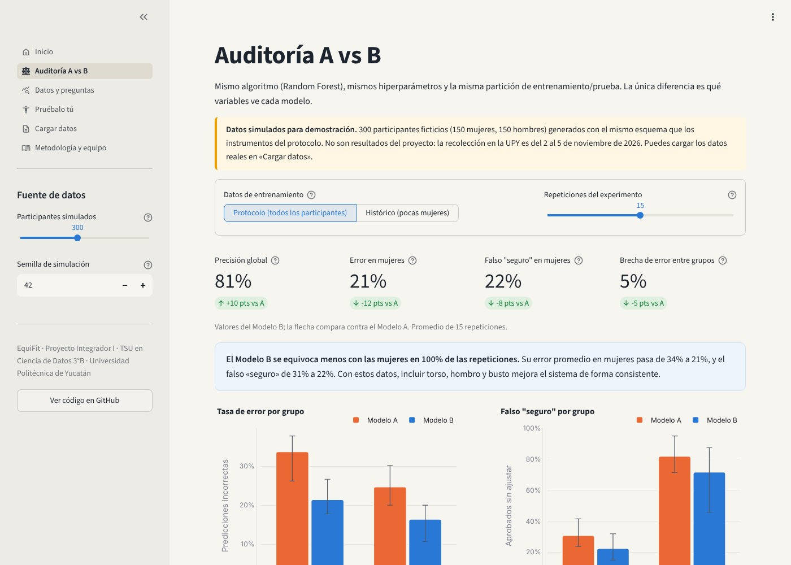
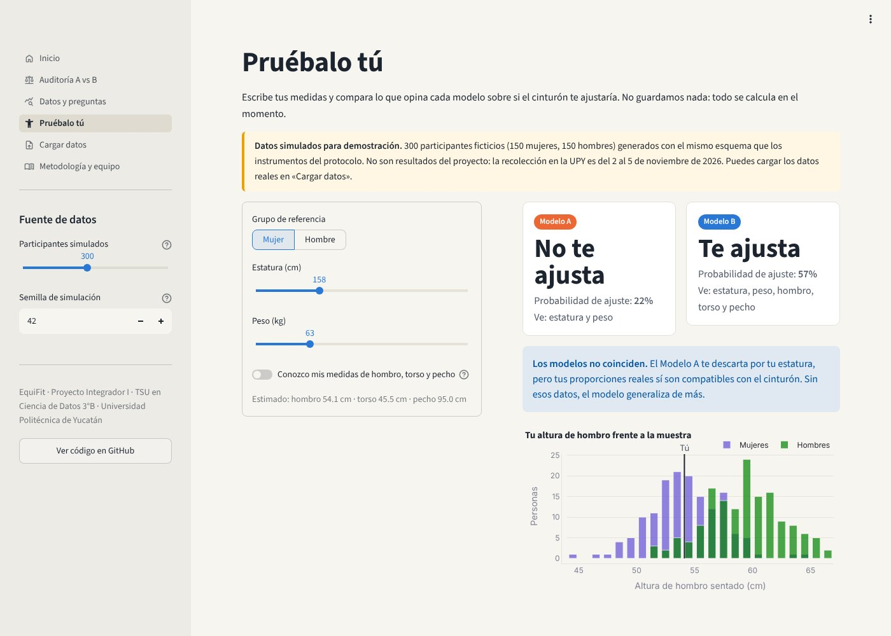

<div align="center">

# EquiFit

**Auditoría de sesgo antropométrico en sistemas de seguridad pasiva mediante aprendizaje automático**

Un sistema que mide cuánto se equivoca un modelo de IA cuando los datos de diseño dejan fuera a las mujeres.
Caso piloto: el cinturón de seguridad vehicular.

[**Demo en vivo**](https://equifit.streamlit.app) · [Página del proyecto](https://armando4322-2.github.io/EquiFit/) · [Cómo ejecutarlo](#ejecutar-en-tu-computadora)

   

*Universidad Politécnica de Yucatán · TSU en Ciencia de Datos 3°B · InnovaFest Mérida 2026*

</div>

---

## El problema

Gran parte de los productos se diseñan con las proporciones del cuerpo masculino como «estándar universal». El maniquí de choque más usado, el Hybrid III, se modeló en 1978 a partir de un hombre de 1.75 m y 77 kg; la versión femenina es, en esencia, una versión reducida del mismo cuerpo.

La consecuencia es medible: en choques frontales, las mujeres con cinturón tuvieron **73 % más probabilidad de lesión grave** que los hombres con cinturón, aun controlando la severidad del choque, la estatura, el índice de masa corporal y el año del vehículo ([Universidad de Virginia, 2019](https://archive.news.virginia.edu/content/study-new-cars-are-safer-women-most-likely-suffer-injury/)).

Cuando los datos no describen a alguien, ni el producto ni los modelos de IA entrenados con esos datos lo atienden igual. A esto se le llama **brecha de datos de género**.

## La solución

EquiFit es una interfaz web que funciona como **sistema de auditoría de datos**. Entrena el mismo algoritmo dos veces con los mismos participantes y solo cambia qué medidas ve:

| Medida | Modelo A · estándar | Modelo B · inclusivo |
|---|:---:|:---:|
| Estatura | ✅ | ✅ |
| Peso | ✅ | ✅ |
| Altura de hombro sentado | — | ✅ |
| Longitud de torso | — | ✅ |
| Contorno de pecho / busto | — | ✅ |

Ambos predicen si el cinturón **ajusta bien (1)** o **no ajusta / genera molestia (0)**. Si el Modelo B se equivoca menos con las mujeres, la diferencia viene exactamente de los datos que antes faltaban.

> El cinturón es nuestra prueba de campo, pero el método sirve para auditar cualquier producto o servicio que se ajusta al cuerpo: asientos, equipo de protección, herramientas, dispositivos médicos, uniformes, mobiliario.

<p align="center"></p>

## Qué hace la demo

| Página | Para qué sirve |
|---|---|
| **Auditoría A vs B** | Precisión global, error por grupo, tasa de **falso «seguro»** (cuántas veces el modelo aprueba un cinturón que no ajusta) y métricas de equidad. Incluye un **escenario histórico** que entrena con muy pocas mujeres. |
| **Datos y preguntas** | Responde la pregunta descriptiva (frecuencia de molestias por grupo) y la correlacional (distancia al «estándar masculino» vs. incomodidad, con Spearman o Pearson según normalidad). |
| **Pruébalo tú** | Para el stand: la persona escribe su estatura y peso y ve si los dos modelos coinciden. |
| **Cargar datos** | Sube los datos de campo (un archivo o los tres instrumentos por separado, unidos por `folio`). Todo se recalcula. |
| **Metodología y equipo** | Diseño experimental, ética y limitaciones. |

<p align="center"></p>

## Diseño experimental

**Pregunta de investigación (aplicada / experimental):** ¿Reduce la brecha de error entre mujeres y hombres entrenar el modelo de ajuste con variables antropométricas femeninas (torso, hombro y busto), frente a entrenarlo solo con el dataset basado en el estándar masculino?

- **Variable independiente:** qué variables ve el modelo (versión A o B).
- **Variables dependientes:** precisión global, tasa de error por grupo, falso «seguro» y métricas de equidad.
- **Controles:** mismo algoritmo (Random Forest), mismos hiperparámetros, misma partición estratificada 70/30.
- **Variable objetivo:** ajusta (1) si el promedio Likert de comodidad y ajuste es ≥ 4 **y** la lista de cotejo no marca corte en el cuello ni presión en el busto; si no, 0. La regla se fijó antes de recolectar.

### Por qué repetimos el experimento

Con la meta de 30 mujeres + 30 hombres, cada partición deja ~9 mujeres en la prueba: el azar puede pesar más que el efecto. EquiFit repite el experimento en varias particiones (A y B **siempre comparten la misma**) y reporta promedio, variación y en qué porcentaje de repeticiones ganó B. Si la diferencia no es concluyente, la app lo dice.

### Por qué no usamos la paridad demográfica como meta

La paridad demográfica pide que el modelo diga «ajusta» igual de seguido a mujeres y hombres. Si el cinturón realmente les ajusta peor a las mujeres, un modelo honesto **debe** decirlo más seguido; forzar la paridad escondería el problema. Por eso priorizamos el error por grupo y el falso «seguro», que comparan la predicción contra lo que de verdad pasó. La métrica se muestra, con esta explicación.

## Sobre los datos

> **La demo usa datos simulados hasta terminar el trabajo de campo (2 al 5 de noviembre de 2026).** No son resultados del proyecto.

Los datos simulados tienen exactamente el esquema de nuestros instrumentos (encuesta, medición antropométrica y lista de cotejo). Sus supuestos están documentados en [`equifit/data.py`](equifit/data.py): distribuciones de referencia para población adulta y un anclaje de cinturón regulable pensado para un hombre promedio. Sirven para que el sistema de auditoría funcione y se pueda revisar antes de tener los datos reales.

Con los datos simulados (300 participantes, 15 repeticiones), el Modelo B baja el error en mujeres de ~34 % a ~21 %. Con 60 participantes simulados, la diferencia ya no es concluyente; eso es un recordatorio útil sobre el tamaño de muestra.

### Formato para cargar los datos reales

Descarga [`datos/plantilla_equifit.csv`](datos/plantilla_equifit.csv). Columnas:

| Columna | Instrumento | Valores |
|---|---|---|
| `folio` | Todos | P001, P002… (sin nombres) |
| `genero` | Encuesta | Mujer / Hombre (acepta F, M, H, femenino, masculino) |
| `estatura_cm`, `peso_kg`, `altura_hombro_sentado_cm`, `longitud_torso_cm`, `contorno_pecho_cm`, `alcance_brazo_cm` | Medición | números |
| `likert_comodidad`, `likert_ajuste` | Encuesta | 1 a 5 |
| `cuello_corta`, `anclaje_adecuado`, `presion_busto` | Lista de cotejo | 1 = sí, 0 = no |

Acepta CSV con coma o punto y coma (Excel en español) y archivos `.xlsx`. La app valida rangos y avisa qué filas descartó.

## Ejecutar en tu computadora

```bash
git clone https://github.com/armando4322-2/EquiFit.git
cd EquiFit
python -m venv .venv
# Windows: .venv\Scripts\activate    ·    macOS/Linux: source .venv/bin/activate
pip install -r requirements.txt
streamlit run app.py
```

Se abre en `http://localhost:8501`.

Auditoría desde la terminal, sin interfaz:

```bash
python scripts/auditoria.py                          # datos simulados
python scripts/auditoria.py datos/campo.csv          # datos reales
python scripts/auditoria.py --historico 0.15         # entrenamiento con 15 % de mujeres
```

Pruebas:

```bash
pip install pytest && pytest -q
```

## Estructura

```
EquiFit/
├── app.py                 # Punto de entrada de Streamlit
├── vistas/                # Páginas del dashboard
├── equifit/
│   ├── config.py          # Variables de A y B, hiperparámetros, regla del objetivo
│   ├── data.py            # Simulación, validación y carga de datos
│   ├── model.py           # Experimento A vs B y repeticiones pareadas
│   ├── metrics.py         # Métricas de desempeño y equidad
│   ├── analysis.py        # Preguntas descriptiva y correlacional
│   └── ui.py              # Estado, caché, estilos y gráficas
├── scripts/auditoria.py   # Auditoría por terminal
├── datos/                 # Plantilla y ejemplo simulado (nunca datos crudos)
├── docs/                  # Página del proyecto (GitHub Pages) y códigos QR
└── tests/                 # Pruebas automáticas
```

## Ética

- Consentimiento informado firmado; participación 100 % voluntaria.
- Sin nombres, correos ni datos personales: cada participante es un folio.
- Solo medidas antropométricas externas; no se piden datos de salud ni información íntima.
- **Los datos crudos de campo no se suben a este repositorio** (`datos/crudos/` está en `.gitignore`).
- El sistema sirve para auditar datos y promover seguridad vial inclusiva, nunca para clasificar personas.

## Limitaciones

- Muestra pequeña y no probabilística: los resultados no se generalizan a toda la población.
- La comodidad es subjetiva; por eso se combina con medición y lista de cotejo.
- Un solo vehículo y un solo cinturón: es una prueba controlada, no una evaluación de la industria.

## Equipo

**Equipo 2 · TSU en Ciencia de Datos 3°B · Universidad Politécnica de Yucatán**

- Ivanna Núñez Hernández
- Luisa Fernanda Trochez Rodríguez
- Camila Berenice Borrego Ayala
- Jesse Velázquez Rojas
- Armando Karin Molina Marrufo

Docente: Omar Adrián Ortiz Monzón · Asignatura: Proyecto Integrador I

## Fuentes

- Universidad de Virginia (2019). *Study: New Cars Are Safer, But Women Most Likely to Suffer Injury.* Sobre Forman et al., *Traffic Injury Prevention*. [Enlace](https://archive.news.virginia.edu/content/study-new-cars-are-safer-women-most-likely-suffer-injury/)
- Manufacturing.net. *Crash Dummies Used in Car Safety Tests Are Still Modeled After Men Despite Higher Risks for Women.* [Enlace](https://www.manufacturing.net/safety/news/22943982/crash-dummies-used-in-car-safety-tests-are-still-modeled-after-men-despite-higher-risks-for-women)

## Licencia

[MIT](LICENSE)
